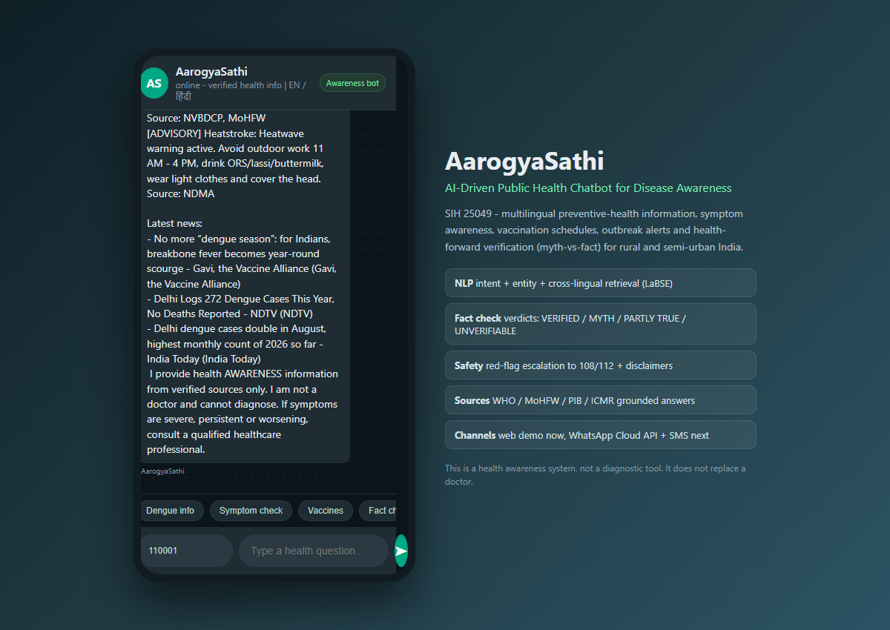

# AarogyaSathi

**A multilingual, retrieval-augmented health-awareness chatbot with built-in claim verification, for WhatsApp and the web.**

Minor project (ES-451) for SIH-25049. It answers preventive-health questions in English, Hindi and Hinglish, checks
forwarded health claims against curated myths and live web evidence, and escalates emergencies without involving an LLM.
Built for rural and semi-urban India.

> Awareness system only. It is not a doctor and never diagnoses.



## What it does

- **Answers health questions** from a curated knowledge base (14 diseases, 35 FAQs, 13 vaccines) with sources from
  WHO, MoHFW and ICMR. The LLM answers only from the retrieved entry and cites it.
- **Fact-checks health claims.** Paste or forward a message and get `VERIFIED`, `MYTH`, `PARTLY TRUE` or `UNVERIFIABLE`
  with a confidence score, an explanation, sources and a fear-mongering flag.
- **Handles emergencies and self-harm first**, with rule-based responses that never call the LLM.
- **Guides symptom reports** with one clarifying question (duration, fever, vomiting) before listing possible
  conditions. It understands negation ("no fever") and never diagnoses.
- **Looks up vaccination schedules** (UIP) by age or pregnancy, and individual vaccines.
- **Tracks outbreaks** with pincode-tagged query spikes against a 7-day baseline (syndromic surveillance).
- **Works across languages**: LaBSE cross-lingual embeddings understand English, Hindi, Hinglish and regional
  languages (Telugu, Tamil and Kannada were tested).

## How it works

```
User (web / WhatsApp / SMS)
      │
      ▼
FastAPI backend ──► router
                      │ 1. red-flag and self-harm check (always first, rule-based, no LLM)
                      │ 2. fact-check trigger detection
                      │ 3. fast path: intent classifier (TF-IDF + LogisticRegression, 13 intents)
                      │    plus whole-word entity matching (symptoms, diseases, vaccines, ages)
                      │ 4. if the fast path is not confident: LLM structured-JSON understanding
                      │ 5. LaBSE cross-lingual retrieval over the curated KB
                      │ 6. RAG generation (LLM tiers with template fallback, grounded in KB context)
                      ▼
        KB (diseases / vaccines / FAQ / myths / alerts, EN+HI) + sources
```

**Retrieval.** Entries are embedded with LaBSE (mean pooling, L2-normalised, cached on disk) and ranked by cosine
similarity plus a lexical-overlap boost.

**Generation.** The LLM receives only the retrieved entry as context, with strict rules: answer only from the
context, under 70 words, in the user's language, no diagnosis, no prescriptions. If no LLM is reachable, the bot
answers from deterministic templates.

**Fact-check pipeline.** A claim is matched against 64 curated myths with LaBSE and disease-aware re-ranking. If no
myth matches, live web evidence is gathered and ranked by source trust (WHO, MoHFW and similar domains first), and an
LLM judge returns structured JSON (verdict, confidence, sources). Otherwise the bot says `UNVERIFIABLE`.

### Safety behaviour

| Message | Response |
|---|---|
| Emergency terms (chest pain, snake bite, seizure, ...) | 108 / 112 guidance, checked before everything else |
| Self-harm phrases | Tele-MANAS (14416 / 1800-891-4416, the national free 24x7 mental health helpline) and 112 |
| An emergency term together with a fact-check request | Emergency guidance, plus a line telling the user to resend the claim on its own |

Entity matching uses whole words, so "tb" does not match inside "outbreak" and "fits" does not match inside
"benefits". Regression tests for these cases are in `tests/test_safety_routing.py`.

### LLM failover

Implemented in `app/core/generator.py`:

1. If `OLLAMA_API_KEY` is set, try Ollama Cloud first (`LLM_CLOUD_MODEL`, default `gpt-oss:20b`).
2. If the cloud call fails (no credits, bad key, quota, timeout), try local Ollama (`LLM_MODEL`, default
   `qwen3:1.7b`). A local failure sets a 60 s cooldown for that tier.
3. If both fail, answer from deterministic templates.

`/api/health` reports the active backend and every chat response includes `llm_backend`. The hosted tier needs
account credits: without them it answers HTTP 402 and the bot uses the local model.

## Tech stack

| Area | Tools |
|---|---|
| API | Python 3.12, FastAPI, Uvicorn, Pydantic |
| Embeddings and retrieval | LaBSE (Hugging Face Transformers), NumPy |
| Classic NLP | scikit-learn (TF-IDF + Logistic Regression), fastText language ID |
| LLMs | Ollama: Qwen3-1.7B (local), gpt-oss-20b (hosted) |
| Live evidence | DuckDuckGo search (`ddgs`) with a whitelisted-domain filter |
| Channels | Web chat UI, Meta WhatsApp Cloud API webhook, Twilio adapter |
| Data | JSON knowledge base, SQLite for surveillance events |
| Ops | systemd on an Oracle Cloud Arm VM, Docker, GitHub Actions |

## Quick start

```powershell
python -m venv venv
venv\Scripts\activate
pip install -r requirements.txt
$env:PYTHONPATH = "$PWD"
python scripts/setup.py          # downloads LaBSE (~2.2 GB) and lid.176.bin (~125 MB), one time
ollama serve                     # optional, needed only for LLM answers
ollama pull qwen3:1.7b           # ~1.3 GB, one time
python -m uvicorn app.main:app --port 8000
```

Open http://127.0.0.1:8000 for the chat UI, or http://127.0.0.1:8000/docs for the API. `scripts/start_dev.ps1` starts
Ollama and the server together. Docker: `docker compose up -d`.

Memory: LaBSE fp16 ~1 GB, Qwen3-1.7B Q4 ~1.6 GB, Python ~0.5 GB, about 3 GB in total.

Optional cloud inference: copy `.env.example` to `.env` and set `OLLAMA_API_KEY` (from ollama.com, needs credits).
`python scripts/test_cloud.py` prints which backend answers.

## API

```bash
curl -X POST http://127.0.0.1:8000/api/chat \
  -H "Content-Type: application/json" \
  -d '{"message": "dengue ke lakshan kya hain", "pincode": "110001"}'
```

Response: `{reply, intent, language, latency_ms, llm_backend, factcheck}`.

## Evaluation and tests

```powershell
python scripts/eval.py      # benchmark report
python -m pytest tests -q   # 72 automated tests
```

| Suite | Result |
|---|---|
| Intent classification (30 queries, EN/HI/Hinglish) | 30/30 |
| Cross-lingual retrieval (15 queries) | 15/15 |
| Health-claim fact check (34 claims) | 34/34 |

These sets were written by the project team: 14 of the 30 intent queries also appear in the training data, and the
benchmark thresholds differ from the production settings. Read them as component checks, not as an estimate of
real-world accuracy or clinical correctness.

## WhatsApp channel

`app/channels/whatsapp.py` implements the Meta WhatsApp Cloud API webhook: verification challenge, HMAC-SHA256
signature check, immediate acknowledgement with background processing, duplicate suppression and reply splitting.
It was demonstrated end to end with a Meta test number and an approved test recipient. Configure it with
`WHATSAPP_TOKEN`, `WHATSAPP_PHONE_ID`, `WHATSAPP_VERIFY_TOKEN` and `WHATSAPP_APP_SECRET` in your private `.env` (see
`.env.example`). Never commit these values. `scripts/configure_meta_whatsapp.py` helps with the subscription setup.
A Twilio adapter is included, but SMS delivery has not been verified.

## Deployment

- **Oracle Cloud Arm VM** (2 OCPU / 12 GiB, free-tier eligible) is what the demo uses. Step-by-step guide:
  `docs/ORACLE_DEPLOY.md`; setup script: `scripts/oracle_setup.sh`; systemd unit: `scripts/healthbot.service`.
- **Deploying an update:** `DEPLOY_HOST=ubuntu@<vm-ip> scripts/deploy.sh` runs the tests, backs up the app folder on
  the VM, uploads the committed files, restarts the service, waits for `/api/health`, sends an emergency-message smoke
  test and rolls back automatically if anything fails. Use `--dry-run` to preview.
- **CI:** `.github/workflows/ci.yml` runs the test suite on every push to `main` and on every pull request.
- **Docker:** `docker compose up -d`. Generic cloud (Render, Railway): see `docs/DEPLOYMENT.md`.

## Known limitations

- The knowledge base is small (14 diseases, 35 FAQs, 64 curated myths). Questions outside it fall back to a
  whitelisted-domain web search or an honest "I don't know".
- Retrieval is cosine similarity over LaBSE embeddings with a lexical boost. There is no vector database, document
  chunking, reranker or hybrid BM25 search yet.
- The benchmarks above are team-written and partly overlap the training data, so they are component checks, not
  an estimate of real-world accuracy.
- The hosted LLM tier needs account credits. Without them the bot runs on the smaller local model, which is slower,
  especially for Hindi, before it falls back to templates.
- Awareness only: not a doctor, never diagnoses.

## Roadmap

- Retrieval: hybrid BM25 + dense search with a reranker, and an evaluation set with recall@k and faithfulness.
- LLM layer: provider-agnostic failover with logged failures and per-provider cooldowns.
- Channels: SMS delivery through Twilio.

## Project layout

```
app/core/          NLP: language, embeddings, intent, entities, retriever, safety, router, generator
app/factcheck/     myth-vs-fact verifier (verdict scores, source tiers)
app/channels/      Meta WhatsApp Cloud API webhook, Twilio adapter, simulator endpoint
app/surveillance/  syndromic early warning (pincode symptom counts vs a 7-day baseline)
data/kb/           curated knowledge base (diseases, vaccines, faq, myths, alerts, messages)
data/training/     intent training examples and a held-out eval set
web/               WhatsApp-style demo UI
scripts/           setup, eval, deploy, smoke tests
tests/             pytest suite
```

## Deliverables

| Item | Location |
|---|---|
| Final project report (DOCX and PDF) | `output/report/` (builder in `output/report/source/`) |
| Second-defense presentation | `output/presentation/` |
| Research paper (final version) | `output/research/AarogyaSathi_Full_Paper_Revised_v10.*` |
| Dated verification evidence | `docs/evidence/` |

## Sources

WHO fact sheets, MoHFW, NHM, IDSP, NTEP and NACO advisories, PIB Fact Check and ICMR, curated for awareness
purposes. Every answer carries a source list and a medical disclaimer.
